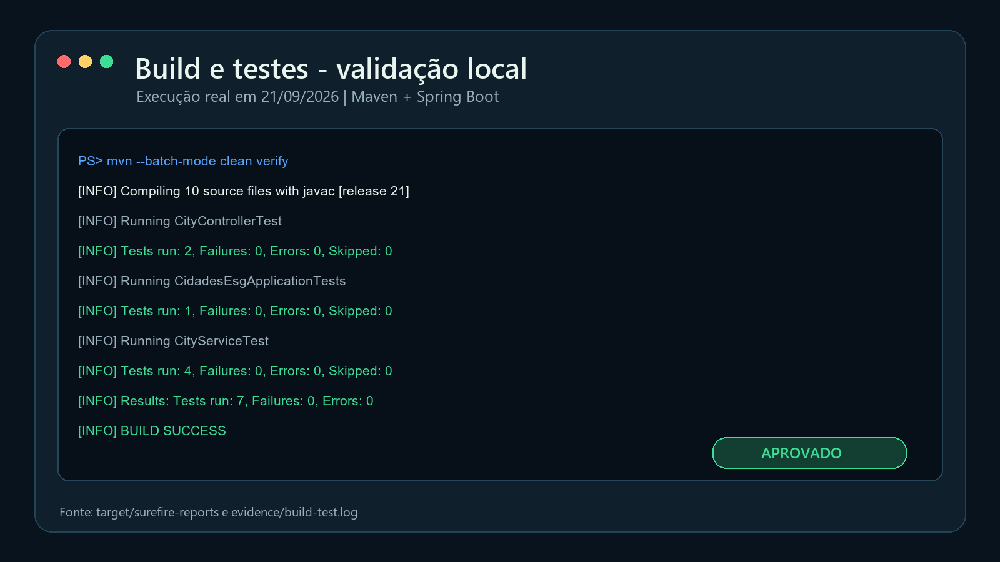
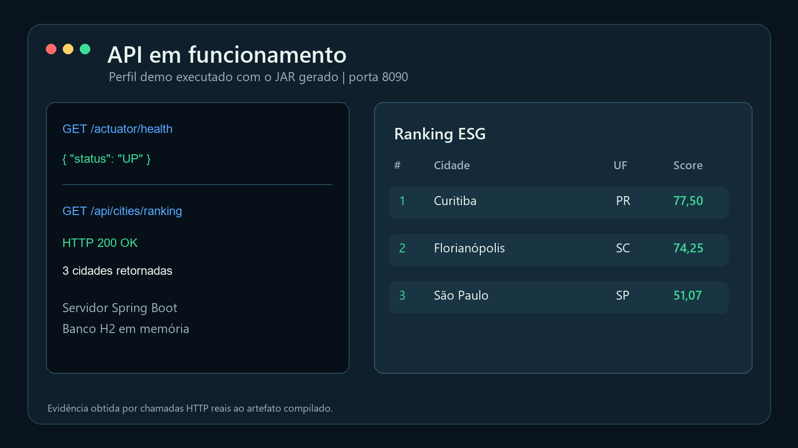
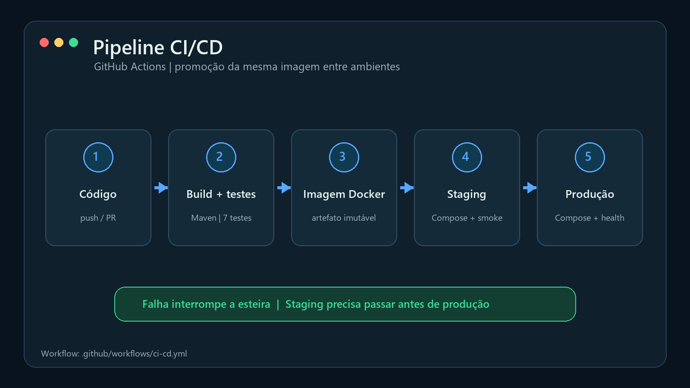

# Projeto - Cidades ESG Inteligentes

> Desafio DevOps - pipeline CI/CD, testes, containerização e orquestração.

## Integrantes

| Nome | RM |
|---|---|
| PREENCHER NOME DO INTEGRANTE | PREENCHER RM |
| PREENCHER NOME DO INTEGRANTE (se houver) | PREENCHER RM |

## Visão geral

O **Cidades ESG Inteligentes** é uma API REST para cadastrar indicadores ambientais de municípios e gerar um ranking ESG. A pontuação combina energia renovável, reciclagem, área verde por habitante e transporte público.

O projeto demonstra um ciclo DevOps completo:

1. o código é compilado (fluxo configurado, execução remota ainda pendente);
2. sete testes automatizados verificam o comportamento;
3. uma imagem Docker imutável é criada;
4. a mesma imagem é promovida para **staging** e depois para **produção**;
5. cada ambiente passa por um *smoke test* e publica evidências.

### Arquitetura

```text
Cliente HTTP
    |
    v
API Spring Boot :8080  ---- health/metrics ----> Spring Actuator
    |
    v
PostgreSQL :5432  <---- schema versionado ------ Flyway

Docker Compose: volume persistente + rede esg-network + variáveis de ambiente
```

### Endpoints principais

| Método | Endpoint | Função |
|---|---|---|
| GET | `/api/cities` | Lista as cidades |
| GET | `/api/cities/ranking` | Ranking por pontuação ESG |
| GET | `/api/cities/{id}` | Busca uma cidade |
| POST | `/api/cities` | Cadastra uma cidade |
| PUT | `/api/cities/{id}` | Atualiza uma cidade |
| DELETE | `/api/cities/{id}` | Exclui uma cidade |
| GET | `/actuator/health` | Verifica a saúde da aplicação |

## Como executar localmente com Docker

### Pré-requisitos

- Docker Desktop com Docker Compose **2.24.4 ou superior** (os overrides usam `!override`).
- Java 21 e Maven para build fora do Docker; Python 3 e curl para os smoke tests.
- Porta `8080` livre; PostgreSQL fica na rede interna, sem porta publicada.
- Execute os comandos abaixo a partir de `cidades-esg-inteligentes/`: `cd cidades-esg-inteligentes`.

### Passos

1. Copie o arquivo de exemplo de variáveis:

   ```bash
   cp .env.example .env
   ```

   No PowerShell, use:

   ```powershell
   Copy-Item .env.example .env
   ```

2. Troque a senha em `.env` e suba os serviços:

   ```bash
   docker compose up --build --detach --wait
   ```

3. Verifique a saúde e o ranking:

   ```bash
   curl http://localhost:8080/actuator/health
   curl http://localhost:8080/api/cities/ranking
   ```

4. Consulte os logs ou encerre o ambiente:

   ```bash
   docker compose logs --follow app
   docker compose down
   ```

   Para também apagar o banco persistido: `docker compose down --volumes`.

### Execução de demonstração sem Docker

O perfil `demo` usa H2 em memória e serve apenas para demonstração local:

```bash
mvn clean package
java -jar target/cidades-esg-inteligentes-1.0.0.jar --spring.profiles.active=demo
```

## Pipeline CI/CD

A automação está em `.github/workflows/ci-cd.yml` **na raiz do repositório**, um nível acima do `pom.xml`. Todos os comandos `run` usam a subpasta `cidades-esg-inteligentes`; caminhos das actions de cache e artefatos incluem essa subpasta. O shell Bash aplica `pipefail`, preservando falhas em comandos com `tee`. A automação usa **GitHub Actions**. Ela é acionada em *pull requests*, em *pushes* para `main` ou manualmente por `workflow_dispatch`.

### Etapas

| Job | O que faz | Regra de avanço |
|---|---|---|
| `build-and-test` | Configura Java 21, compila com Maven, executa 7 testes, cria o JAR e a imagem Docker | Qualquer falha interrompe o pipeline |
| `deploy-staging` | Carrega exatamente a imagem aprovada, sobe aplicação + PostgreSQL na porta 8081 e executa health check e ranking | Só roda após build/testes aprovados |
| `deploy-production` | Promove a mesma imagem para a porta 8082 e executa health check | Só roda após staging aprovado |

Os ambientes `staging` e `production` ficam registrados na área **Deployments** do GitHub. Para uma proteção extra, configure o ambiente `production` em **Settings > Environments > production** com *required reviewers*; assim, a etapa de produção aguarda aprovação humana.

Neste projeto acadêmico, os ambientes do pipeline são containers efêmeros no próprio *runner* do GitHub: eles sobem, são testados, geram artefatos de evidência e são encerrados. Para manter uma URL pública permanente, o mesmo job pode ser apontado para um servidor próprio ou serviço de nuvem por meio de segredos do ambiente.

### Artefatos gerados pelo pipeline

- `relatorios-de-testes`: relatórios JUnit do Maven;
- `evidencias-staging`: log do deploy, JSON do health check e ranking;
- `evidencias-production`: log do deploy e JSON do health check;
- registro separado dos ambientes `staging` e `production` no GitHub.

## Containerização

### Dockerfile

```dockerfile
# syntax=docker/dockerfile:1.7
FROM maven:3.9.11-eclipse-temurin-21-alpine AS build
WORKDIR /workspace

COPY pom.xml .
RUN --mount=type=cache,target=/root/.m2 mvn -B dependency:go-offline

COPY src ./src
RUN --mount=type=cache,target=/root/.m2 mvn -B clean package

FROM eclipse-temurin:21-jre-alpine AS runtime
WORKDIR /app

RUN addgroup -S spring && adduser -S spring -G spring
COPY --from=build --chown=spring:spring /workspace/target/cidades-esg-inteligentes-1.0.0.jar app.jar

USER spring:spring
EXPOSE 8080

HEALTHCHECK --interval=15s --timeout=3s --start-period=35s --retries=5 \
  CMD wget -qO- http://localhost:8080/actuator/health/readiness || exit 1

ENTRYPOINT ["java", "-XX:MaxRAMPercentage=75.0", "-jar", "/app/app.jar"]
```

### Estratégias adotadas

- **Build multiestágio:** o Maven fica somente na fase de construção; a imagem final leva apenas o Java e o JAR.
- **Cache de dependências:** acelera builds repetidos.
- **Usuário sem privilégios:** a aplicação não roda como `root`.
- **Health check:** Docker e pipeline detectam se a API realmente está pronta.
- **Imagem imutável:** staging e produção recebem o mesmo pacote, reduzindo diferenças entre ambientes.
- **Configuração externa:** credenciais, porta e perfil entram por variáveis de ambiente.

### Orquestração com Docker Compose

O `docker-compose.yml` organiza dois serviços:

- `app`: API Spring Boot;
- `database`: PostgreSQL 17.

Também são utilizados:

- volume nomeado `postgres-data`, para persistência;
- rede `esg-network`, para comunicação interna;
- `depends_on` com health check, para a API aguardar o banco;
- variáveis definidas no `.env` local ou no job do pipeline;
- arquivos de *override* para `staging` e `production`.

## Prints do funcionamento

### Build e testes locais verificados



### API executada localmente



### Fluxo automatizado configurado



> **Antes da entrega final:** publique este projeto em um repositório GitHub, execute o workflow e acrescente aqui os prints reais da página **Actions** mostrando os três jobs verdes e da página **Deployments** mostrando `staging` e `production`. Não foram usados prints falsos: as imagens acima registram as validações locais reais e o fluxo configurado.

O roteiro detalhado para gerar as últimas evidências está em `docs/GUIA-EVIDENCIAS.md`.

## Tecnologias utilizadas

| Tecnologia | Uso no projeto |
|---|---|
| Java 21 | Linguagem da aplicação |
| Spring Boot 3.5.6 | API REST e configuração |
| Spring Data JPA / Hibernate | Persistência de dados |
| Bean Validation | Validação das requisições |
| Spring Actuator | Health checks e métricas |
| PostgreSQL 17 | Banco dos ambientes Docker |
| Flyway | Versionamento do schema |
| H2 | Testes e perfil de demonstração |
| JUnit 5, Mockito e MockMvc | Testes unitários, de controller e de contexto |
| Maven 3.9 | Build e dependências |
| Docker | Empacotamento da aplicação |
| Docker Compose | Orquestração de aplicação, banco, volume e rede |
| GitHub Actions | CI/CD com build, testes e deploy em dois ambientes |

## Testes automatizados

Execute:

```bash
mvn clean verify
```

Coberturas funcionais implementadas:

- inicialização completa do contexto Spring;
- cálculo ponderado da pontuação ESG;
- ordenação do ranking;
- normalização da UF;
- tratamento de cidade inexistente;
- listagem REST;
- rejeição de payload inválido.

Há evidência histórica local de 21/09/2026 em `docs/evidencias/`. Nesta revisão de 13/10/2026, Java, Maven e Docker estão indisponíveis: os testes Java e o build Docker não foram reexecutados. Consulte `docs/RELATORIO-CICD.md` para os resultados e limites desta revisão.

## Desafios encontrados e soluções

| Desafio | Solução adotada |
|---|---|
| Garantir igualdade entre ambientes | A mesma imagem Docker gerada no build é promovida para staging e produção |
| Evitar a API iniciar antes do banco | Health check do PostgreSQL combinado com `depends_on` |
| Não expor senhas no Git | `.env` está ignorado; apenas `.env.example` sem credencial real é versionado |
| Validar deploy automaticamente | Script de *smoke test* chama readiness e endpoint funcional |
| Atualizar banco com segurança | Migração SQL versionada pelo Flyway |
| Produzir evidência mesmo sem Docker nesta máquina | Perfil H2 `demo` validou o JAR, health check e ranking sem substituir a configuração PostgreSQL/Docker |

## Estrutura do projeto

```text
raiz-do-repositorio/
|-- .github/workflows/ci-cd.yml
|-- Documentacao_Tecnica_Cidades_ESG_Inteligentes.pdf
`-- cidades-esg-inteligentes/
|-- docs/
|   |-- GUIA-EVIDENCIAS.md
|   `-- evidencias/
|-- scripts/
|   |-- deploy-environment.sh
|   |-- smoke-test.sh
|   `-- validate-project.ps1
|-- src/main/
|-- src/test/
|-- .env.example
|-- Dockerfile
|-- docker-compose.yml
|-- docker-compose.staging.yml
|-- docker-compose.production.yml
|-- pom.xml
`-- README.md
```

## Checklist de entrega

| Item | OK |
|---|:---:|
| ZIP final atualizado | ☐ gerar após validar no GitHub |
| Dockerfile multi-stage revisado | ☑ revisão; execução Docker pendente |
| `docker-compose.yml` com aplicação, banco, volume, variáveis e rede | ☑ |
| Pipeline configurado na raiz com três jobs encadeados | ☑ configuração; execução remota pendente |
| README com instruções e evidências locais | ☑ |
| PDF preservado e alinhado à revisão atual | ☐ atualizar caminhos, validações e prints reais |
| Deploy executado nos ambientes do GitHub | ☐ após publicar e rodar o workflow |
| Prints reais do GitHub Actions/Deployments adicionados | ☐ após a primeira execução |
| Nome e RM dos integrantes preenchidos no README e no PDF | ☐ preencher antes do envio |

## Observações de segurança

- Nunca envie o arquivo `.env` com senhas reais.
- Em um servidor permanente, salve segredos em **GitHub Environments/Secrets**.
- Proteja `production` com aprovação obrigatória.
- Troque imediatamente as senhas de exemplo.

## Deploy e validação dos ambientes

A partir de `cidades-esg-inteligentes/`, configure `.env` com uma senha local e construa a imagem:

```bash
docker build -t cidades-esg:local .
./scripts/deploy-environment.sh staging
./scripts/deploy-environment.sh production
curl --fail http://localhost:8081/actuator/health
curl --fail http://localhost:8081/api/cities/ranking
curl --fail http://localhost:8082/actuator/health
curl --fail http://localhost:8082/api/cities/ranking
```

O script fixa staging em 8081 e produção em 8082, independentemente de `APP_PORT` no `.env`. Os overrides substituem a lista de portas com `!override`. Os projetos Compose `cidades-esg-staging` e `cidades-esg-production` mantêm bancos, volumes e redes separados; os bancos também têm nomes distintos. Produção desativa seed e pode retornar listas vazias válidas.

Para validar a configuração sem iniciar containers (requer senha no `.env`):

```bash
docker compose config --quiet
docker compose -p cidades-esg-staging -f docker-compose.yml -f docker-compose.staging.yml config --quiet
docker compose -p cidades-esg-production -f docker-compose.yml -f docker-compose.production.yml config --quiet
```

`docker compose ... down` preserva volumes locais. O pipeline usa `down -v` apenas para limpar os ambientes efêmeros. Não execute essa opção em um banco que deseja preservar.

O smoke test exige HTTP bem-sucedido, JSON válido, health/readiness `UP` e listas de cidades/ranking no formato esperado. `EVIDENCE_DIR` define onde salvar respostas; sem essa variável usa uma pasta temporária exclusiva. O workflow gera uma senha aleatória por job, mascara-a e coleta logs/estado dos containers antes da limpeza, inclusive em falhas.

## Pendências para entrega FIAP

Preencher nomes e RMs, executar o pipeline no GitHub e anexar prints reais conforme `docs/GUIA-EVIDENCIAS.md`. O PDF original foi preservado; revisar nele a localização do workflow, Compose mínimo 2.24.4, isolamento/portas, senha temporária, status de validação e evidências da execução remota. Nenhum deploy permanente foi criado nesta revisão.
